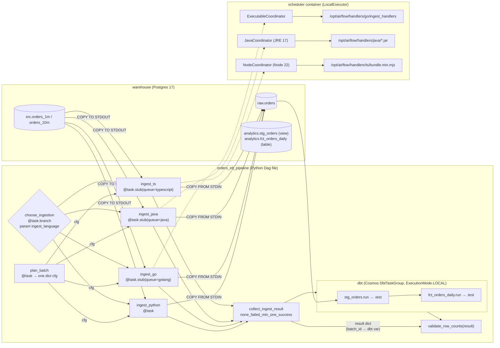

# Polyglot ELT on Airflow 3.4: Go/Java/TS/Python ingestion + dbt via Cosmos

One Airflow 3.4.0 Dag, `orders_elt_pipeline`, that:

1. lands `src.orders_*` (Postgres) into `raw.orders` with an ingestion task written in
   **Python, Go, Java or TypeScript**, picked per run by the `ingest_language` param
   (default `auto`: the measured winner for the table, **Go for 1M rows and Java for 10M**);
2. transforms it with **dbt** through an **astronomer-cosmos `DbtTaskGroup`**;
3. checks that row counts agree from source to mart.

The ingestion language was chosen by measurement (48 runs, n=6 per language and size).
See [BENCHMARK.md](BENCHMARK.md). Short version: Postgres sets the pace of COPY→COPY, so wall
time is a tie. Go has the lowest startup and memory (15 MB). Java uses the least CPU at 10M
(2.7 s vs 6.2 s Go and 13.0 s Python), and its 0.35 s JVM startup is then under 3% of the task.

Everything runs locally in docker compose. Nothing is pushed or published.

## Architecture



Every ingestion implementation does the same work: open two connections, `TRUNCATE` the
target and `COPY src TO STDOUT` → per-row step → `COPY target FROM STDIN` in one transaction.
The per-row step checks that the row has 8 fields, appends `\t<batch_id>` and counts the row.
Output is written in ~1 MiB chunks.

| piece | where |
|---|---|
| Python Dag files | [dags/orders_elt_pipeline.py](dags/orders_elt_pipeline.py), [dags/ingest_bench.py](dags/ingest_bench.py) |
| Python ingestion + metrics | [dags/elt_common/](dags/elt_common/) |
| Go handlers (pgx v5) | [handlers/go/](handlers/go/) |
| Java handlers (pgJDBC CopyManager) | [handlers/java/](handlers/java/) |
| TypeScript handlers (pg + pg-copy-streams) | [handlers/ts/src/main.ts](handlers/ts/src/main.ts) |
| dbt project | [dbt/orders/](dbt/orders/) |
| image (JRE 17 + Node 22 + Go/Java/TS bundles + dbt venv) | [Dockerfile](Dockerfile) |
| stack | [docker-compose.yml](docker-compose.yml) |
| benchmark driver + summary | [bench/](bench/) |

### Cross-language contract

`plan_batch` returns **one dict**, and each ingestion stub receives it **whole** as `cfg`:

```python
{"batch_id": "<run_id>", "source_table": "src.orders_1m", "target_table": "raw.orders", "conn_id": "pg_warehouse"}
```

Each ingestion returns **one dict** (its return-value XCom): `batch_id`, `language`,
`row_count`, `source_table`, `target_table`, plus timing and memory metrics.
`collect_ingest_result` passes on whichever result exists. `validate_row_counts` receives
that dict whole. The dbt task group reads `batch_id` from it through a templated `vars` entry:

```python
operator_args={"vars": {"batch_id": "{{ ti.xcom_pull(task_ids='collect_ingest_result')['batch_id'] }}"}}
```

`vars` is one of Cosmos's local-operator `template_fields` (checked in the built image).
`stg_orders` filters `raw.orders` to that batch.

### Choosing the ingestion language

- **Default `auto`**: picks from `INGEST_LANGUAGE_BY_TABLE` in
  [dags/elt_common/__init__.py](dags/elt_common/__init__.py) (`orders_1m → go`,
  `orders_10m → java`), as decided in BENCHMARK.md. `choose_ingestion` logs the choice.
- **Per run**: the `ingest_language` param (`auto | python | go | java | ts`), e.g.
  `make run INGEST_LANG=java`, or *Trigger Dag w/ config* in the UI.
- **Per deployment**: the `INGEST_LANGUAGE` env var (compose passes it through; default `auto`)
  sets the param's default.

### Cosmos: ExecutionMode and LoadMode

- **`ExecutionMode.LOCAL` with `dbt_executable_path=/opt/airflow/dbt-venv/bin/dbt`.** dbt runs
  as a subprocess of the LocalExecutor task, in the scheduler container. It needs no Docker
  socket (unlike `DOCKER`) and no cluster (unlike `KUBERNETES`). It also doesn't build a
  virtualenv per task (unlike `VIRTUALENV`), which adds seconds to every model. dbt-core 1.12 /
  dbt-postgres 1.11 live in their own venv, so their pins never conflict with Airflow 3.4's.
- **`LoadMode.DBT_MANIFEST`.** `dbt parse` runs once at image build and the manifest ships in
  the image. Dag parsing (every 30 s here) then never starts dbt. `DBT_LS` would run `dbt ls`
  during parsing, and `CUSTOM` drops dbt's selector semantics. The cost: after changing a
  model, rebuild the image (`make up`) so the manifest matches.
- `select=["tag:orders"]` (tags set in `dbt_project.yml`), so new models are picked up without
  touching Python. `TestBehavior.AFTER_EACH` gives each model a run task and a test task.
- `test_indirect_selection=BUILDABLE`. With the default (eager), the singular test
  `assert_mart_counts_match_staging` (which refs both models) was selected by
  `stg_orders.test` and failed, because `fct_orders_daily` didn't exist yet. That failure was
  observed here. With buildable it runs in `fct_orders_daily.test`, where it passes.
- Per-run `--vars` invalidate dbt's partial parse, so each dbt task re-parses the (tiny)
  project. That's acceptable here. On a large project, pass the batch through an env var instead.

## How to run

Prerequisites: Docker with about 8 GB of memory, `make`, `python3` (stdlib only, for the bench
driver). Port 18080 (Airflow) and 55432 (warehouse Postgres) must be free. Override with
`AIRFLOW_PORT=...`.

```bash
make up
```

```bash
make seed
```

```bash
make run TABLE=orders_1m
```

```bash
make bench REPEATS=3
```

```bash
make down
```

- `make up` builds the image (Go/Java/TS bundles are compiled inside it) and starts
  metadb, the warehouse, api-server, scheduler and dag-processor.
- `make seed` creates `src.orders_1m` and `src.orders_10m` with deterministic data
  (about 45 s).
- `make run` triggers `orders_elt_pipeline` (default `INGEST_LANG=auto`), waits, and prints
  task states plus the validation XCom.
- `make bench` runs `ingest_bench` 3× per language and table, writing
  `results/bench_raw.jsonl` and `results/bench_summary.md`.
- `make clean` instead of `make down` also deletes the volumes.

The UI is at http://localhost:18080. The simple auth manager runs with
`SIMPLE_AUTH_MANAGER_ALL_ADMINS=True`, so there's no login. That's for a local demo only.

## Known constraints

These were given up front and the code respects them:

- **A `@task.stub` can only take an upstream's whole return value.** Indexing an output by a
  custom XCom key (`multiple_outputs=True` + `cfg["key"]`) fails Dag serialization. So
  `plan_batch` returns one dict and the stubs take it whole as `cfg`.
- **Go decodes a dict into a struct strictly (`DisallowUnknownFields`).** An extra key fails
  the task. `BatchConfig` in [handlers/go/ingest.go](handlers/go/ingest.go) lists exactly the
  keys `plan_batch` returns. A lone struct parameter binds *by field name* to the stub's
  arguments, so the dict is wrapped: `IngestArgs{Cfg BatchConfig \`arg:"cfg"\`}`.
- **Java behaves the same for typed inputs.** The SDK converts with a default Jackson mapper
  (fails on unknown properties, names matched exactly), so `IngestTask.BatchConfig` uses
  `@JsonProperty("batch_id")` etc.
- **Java SDK: Jackson is runtime-scoped**, so `jackson-annotations` is declared explicitly in
  [pom.xml](handlers/java/pom.xml), at the SDK's version. `Connection.extra` arrives as a JSON
  string; this demo doesn't read it.
- **From Scala** (not used here; Java was chosen): use `Task`/`DagDef`/`Bundle.register` (no
  `@Airflow.Dag`/`@Airflow.Deps` under scalac). `TaskInput` must be a Java class. Convert
  collections with `.asJava` before `setXCom`.

Found while building this (verified in this repo):

- **Task-instance `start_date` is stamped partway through spawning a stub's process.** A JVM
  no-op reported its process had been alive ~0.4 s when the handler began, while the whole TI
  "duration" was ~0.2 s. The benchmark therefore measures startup as `queued_when → end_date`
  and reports TI duration only alongside it.
- **The base image is Debian trixie (hardened)**, which doesn't package JDK 17 or have `curl`.
  The Dockerfile copies `/opt/java/openjdk` from `eclipse-temurin:17-jre` and `node` from
  `node:22-bookworm-slim`. The api-server healthcheck uses Python.
- **`@apache-airflow/ts-sdk@1.0.0` has a peer dependency on `esbuild@^0.28.2`.** `npm install`
  fails with an older esbuild.
- **The handler bundles each live in their own Dag bundle with an `.airflowignore` of `*`.**
  The coordinators scan the directory for the executable/JARs/`.min.mjs`, and the Dag
  processor never tries to parse them.
- **Task logs in the UI need a shared `[api] secret_key`** across components. Without it the
  api-server can't fetch logs from the scheduler's log server, and the UI shows a "secret_key"
  error instead. It's set in compose.
- **JavaCoordinator puts every JAR in the bundle on the classpath.** Dependency JARs ship
  unshaded, so the SDK JAR keeps its `Airflow-Supervisor-Schema-Version` manifest entry.
  `main_class` is set explicitly in the coordinator kwargs.
